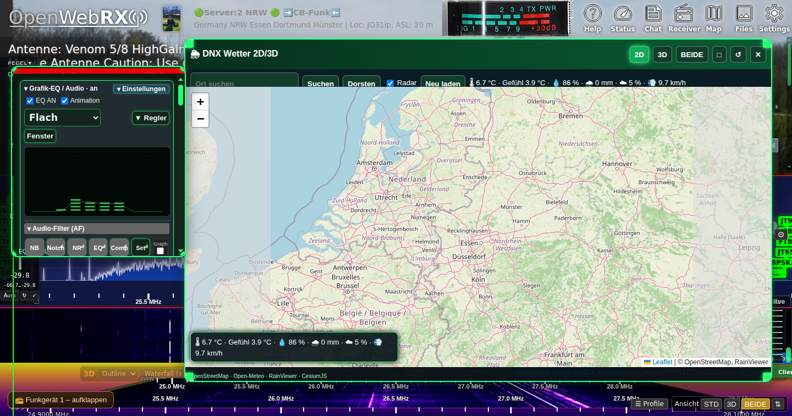
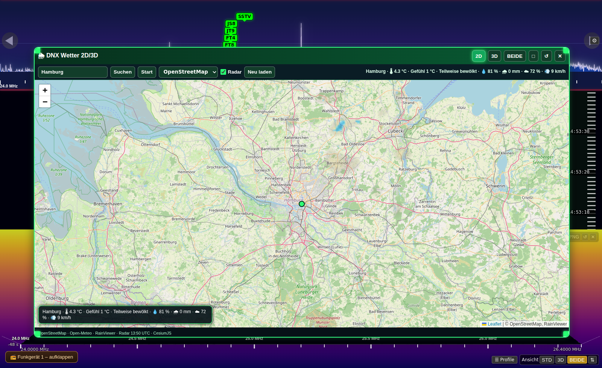
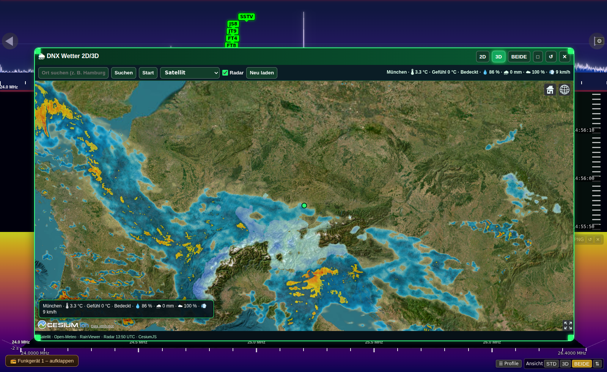
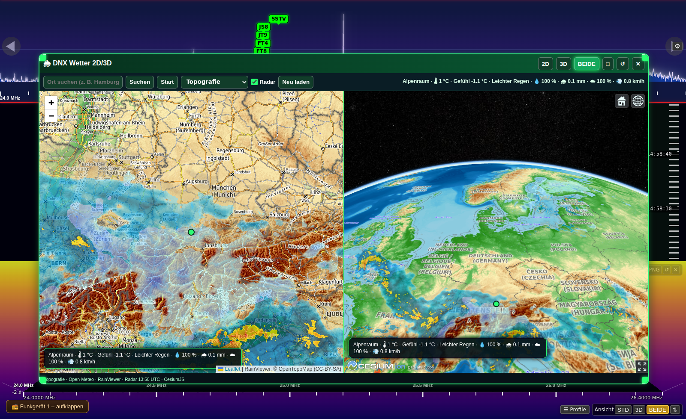
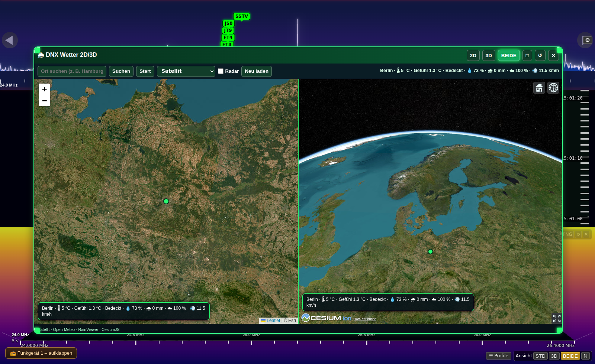

# DNX Wetter 2D/3D (`v1.1.0`)

<!-- DNX-DISCLAIMER-START -->
> **Wichtiger Hinweis / Vollständige Distanzierung (Hobby-Mod-Mode)**
>
> - **Vollständige Distanzierung:** Ich distanziere mich in jeder Hinsicht vollständig vom Projekt **OpenWebRX / OpenWebRX+** sowie dessen Entwicklern und Betreibern. Es besteht keinerlei Verbindung, Zusammenarbeit, Prüfung, Befürwortung oder Partnerschaft.
> - **Keine öffentlichen/offiziellen OpenWebRX-Plugins (nur Mod-Mode):** Bei diesem Projekt handelt es sich ausdrücklich **nicht** um ein öffentliches oder offizielles Plugin von OpenWebRX, sondern ausschließlich um einen privaten, inoffiziellen **Mod-Mode** (Eigenmodifikation).
> - **Warum bewusst kein reines Browser-JavaScript (Mod-Mode-Architektur):** Viele Funktionen (z. B. serverseitige Speicherung, Konten-/Rollenverwaltung, Profil-Synchronisation, VNC-/websockify-Brücken, geschützte Schnittstellen, Docker-/Systemintegration und stabile UI-Anpassungen) lassen sich sauber und sicher nicht allein über simples Client-JavaScript umsetzen, ohne den OpenWebRX-Kern umzubauen oder Browsergrenzen zu umgehen. Deshalb setzt dieses Projekt bewusst auf getrennte Begleitmodule, Shell-Installer und Dienste im **Mod-Mode** statt alles künstlich in reines JavaScript zu pressen.
> - **Kein öffentlicher Support & keine Haftung:** Es gibt **keinen öffentlichen Support**, keine Garantie und keine Haftung. Nutzung, Installation und Anpassung erfolgen vollständig auf eigene Gefahr (immer vorher Backups anlegen und zunächst im eigenen Testsystem prüfen).
> - **Reines Hobbyprojekt – frei nutzbar, änderbar & verbreitbar:** Dieses Projekt entsteht ausschließlich aus reinem Hobby und Interesse am gemeinsamen Funk-/SDR-Hobby. Es steht ausdrücklich frei zur Verfügung und darf frei genutzt, weiterverbreitet, verändert und verbessert werden.
<!-- DNX-DISCLAIMER-END -->

> **Important Notice / Full Disassociation (Hobby Mod-Mode Only)**
>
> - **Full Disassociation:** I completely disassociate myself from **OpenWebRX / OpenWebRX+** and its developers/maintainers. There is no affiliation, endorsement, review, or partnership of any kind.
> - **No Official/Public OpenWebRX Plugins (Mod-Mode Only):** These files are **not** official or public OpenWebRX plugins, but purely unofficial hobby modifications (*mod-mode*).
> - **No Public Support & No Warranty:** There is **no public support**, no warranty, and no liability. Use entirely at your own risk.

<!-- DNX-PREVIEW-START -->
## Live-Vorschau & Galerie (`DNX Wetter 2D/3D`)



| Ansicht | Beschreibung | Screenshot |
|---|---|---|
| **Gesamtansicht (BEIDE)** | Parallelansicht mit 2D-Leaflet (`OpenStreetMap`), 3D-Cesium-Erdkugel, live **RainViewer**-Niederschlagsradar & **Open-Meteo**-Wetterdaten |  |
| **2D-Karte & Ortssuche** | Einzelansicht `2D` nach Live-Ortssuche (`Hamburg` über Nominatim) mit Zielmarkierung, Niederschlagsradar & Wetterleiste |  |
| **3D-Cesium-Erdkugel (Satellit)** | Vollansicht `3D` auf **CesiumJS 1.121** mit `Satellit` (Esri) und live RainViewer-Regenfront über Mitteleuropa & Alpen |  |
| **Topografie & Niederschlagsradar** | Kartenstil `Topografie` (`OpenTopoMap`) in `BEIDE` (2D + 3D) inklusive aktivem Regenradar über dem Alpenraum |  |
| **Satelliten-Vergleich ohne Radar** | Umschaltbares `Radar`-Overlay (`aus`) mit reiner `Satellit`-Ansicht (`Berlin`) in 2D und 3D-Weltraumperspektive |  |
<!-- DNX-PREVIEW-END -->

Eigenständiges, bewegliches und skalierbares Wetterfenster (**2D-Karte + 3D-Cesium-Erdkugel**) für kompatible OpenWebRX-/OpenWebRX+-Installationen. **Release `v1.1.0`.**

## Neu in v1.1.0

- **3D-Basiskarten-Fix für CesiumJS 1.121 (`baseLayer` statt entferntem `imageryProvider`):** Die 3D-Erdkugel lädt OpenStreetMap, Esri-Satellit und OpenTopoMap wieder zuverlässig mit voller Tageslicht-Darstellung (`enableLighting = false`, `highDynamicRange = false`) und `requestRenderMode` (deutlich geringere CPU-/GPU-Last).
- **Kartenstil-Auswahl synchron in 2D & 3D:** Direktumschaltung zwischen `OpenStreetMap`, `Satellit` und `Topografie` (`OpenTopoMap`).
- **Komfort & Bedienung:** Enter-Taste im Suchfeld, `Start`-Knopf (Mitteleuropa/Deutschland `51.16° N, 10.45° E`), Cesium-Home-Button-Anbindung, 2D/3D-Standortmarkierung, WMO-Wetterbeschreibung in Echtzeit (`Open-Meteo`), Zoom-begrenztes RainViewer-Radar (`maxNativeZoom: 7`) inkl. Zeitstempel sowie überlappungsfreie Info-Box-Anordnung.
- **Bereinigter Mod-Mode-Export:** Ohne fest hinterlegte lokale IP-Adressen oder private Standortvorgaben; universeller `install.sh` für Docker- und Standard-Installationen (`TYP=docker` / `TYP=normal`).

## Funktionen

- **2D-Karte (`Leaflet`):** `OpenStreetMap`, `Satellit` (`Esri World Imagery`) & `Topografie` (`OpenTopoMap`), Live-Klick-Wetterabfrage und synchronisierte Zielmarkierung.
- **3D-Erdkugel (`CesiumJS 1.121`):** Hardware-/WebGL-Globus mit synchron umschaltbarem Kartenstil, Regenradar-Overlay, Home-Button-Rücksprung, synchroner 3D-Stecknadel und 3D-Klick-Wetterabfrage.
- **Ansichtsmodi & Fenstersteuerung:** `2D`, `3D` und `BEIDE` (Split-Grid), Maximieren (`□`), Zurücksetzen (`↺`), Schließen (`✕`), Verschieben an der Titelzeile sowie 8 Resize-Kanten/-Ecken im grünen DNX-Rahmen.
- **Live-Wetter, Radar & Ortsbeobachtung:**
  - **`Open-Meteo`-Livewerte:** Temperatur, gefühlte Temperatur, detaillierter WMO-Wetterzustand im Klartext (inkl. *Klar*, *Bewölkt*, *Nebel*, *Regen*, *Schnee*, *Schauer*, *Gewitter*, *Gewitter mit Hagel*, *Starkes Gewitter*), Luftfeuchtigkeit, Niederschlag (`mm`), Bewölkung (`%`) und Windgeschwindigkeit (`km/h`).
  - **`RainViewer`-Niederschlagsradar:** Zuschaltbares (`Radar`-Checkbox) und manuell aktualisierbares (`Neu laden`) Regenradar mit UTC-Zeitstempel auf 2D-Karte und 3D-Globus.
  - **`Nominatim`-Ortssuche:** Weltweite Ortssuche (`Enter` oder `Suchen`) mit automatischem Kameraflug in 2D & 3D sowie `Start`-Rücksprung.
- **Persistenz:** Speicherung von Fensterposition/-größe, Ansichtsmodus (`2D`/`3D`/`BEIDE`), Kartenstil, Radarstatus und letzter Position/Ortsbezeichnung im Browser (`localStorage`).

> **Abgrenzung zu `DNX MultiSDR`:** Dieses eigenständige OpenWebRX+-Wetterfenster konzentriert sich auf die 2D-/3D-Karten-, Radar- und Open-Meteo-Liveansicht; es enthält **keine** Sprachansagen/Sprachsteuerung, **keinen** Blitzalarm mit Umkreis/Ton, **keine** Nowcast-Gewitterzugbahn mit Radar-Animation/Screenshot-Export und **keine** Browser-GPS-Standortübernahme (`navigator.geolocation`). Diese Funktionen sind Bestandteil der separaten **DNX MultiSDR**-Plattform (`Wetterzentrale`, `Gewitter-/Unwetter-Module`, `ADS-B Sprache` & `dnx-befehl.js` Sprachsteuerung).

## Paketinhalt

| Datei | Zweck |
|---|---|
| `dnx_weather.js` | Frontend-Modul `v1.1.0` (`window.DNXWeather2D3D`) |
| `dnx_weather.css` | Fenster-, Toolbar-, Karten- und Resize-Styling |
| `install.sh` | Installer / Updater / Status / Deinstaller (`docker` & `normal`) |
| `docs/` | 5 bereinigte Live-Screenshots (`1600×980`) |
| `LICENSE` | MIT-Lizenz |
| `SHA256SUMS.txt` | Prüfsummen aller Paketdateien |

## Installation (`install.sh`)

```bash
chmod +x install.sh
sudo ./install.sh install
```

Optional mit expliziter Zielangabe:

```bash
sudo TYP=docker CONTAINER=openwebrx ./install.sh install
# oder für native Linux-Installation:
sudo TYP=normal PLUGINS=/usr/lib/python3/dist-packages/htdocs/plugins ./install.sh install
```

Der Installer sichert vorhandene Dateien unter `/opt/dnx-weather-backups`, lädt bei Bedarf `Leaflet 1.9.4` und `CesiumJS 1.121.0` einmalig lokal ins Pluginverzeichnis `dnx_weather/vendor/` und bindet den Lader in `init.js` ein.

```bash
./install.sh status      # Status prüfen
sudo ./install.sh update # Aktualisieren
sudo ./install.sh uninstall # Sauber entfernen (Backups bleiben erhalten)
```

## Externe Datenquellen & Hinweise

- **OpenStreetMap-Mitwirkende** – Straßenkarte & Nominatim-Ortssuche
- **Esri / World Imagery** – Satelliten-Basiskarte
- **OpenTopoMap (CC-BY-SA)** – Topografische Karte
- **Open-Meteo** – Aktuelle Wetterdaten
- **RainViewer** – Niederschlagsradar-Kacheln
- **CesiumJS & Leaflet** – 3D-/2D-Kartenbibliotheken

Die jeweiligen Nutzungsbedingungen, Lizenzen und Abruflimits sind vom Betreiber zu beachten. Nicht für sicherheitskritische Warnungen verwenden.

---

## Verbindungen im DNX-Ökosystem


* **Verbindung zu `DNX-Styler` (`#dnx-weather-win` & `t_wetter`):** Im Styler-Block `#dnx-blk-tools` steuert **`DNX Wetter`** (`t_wetter` / `#dnx-weather-launch`) die 2D-Leaflet- und 3D-Cesium-Wetteransicht; schwebt ergänzend neben **`t_magnet` (`Magnetfeld`)** und **`t_iss` (`ISS`)**.
* **Verbindung zu `DNX-Receiver-Account-Control`:** Das Recht **`weather`** aus `:8095/api/me` steuert die Freigabe pro Benutzerrolle.
